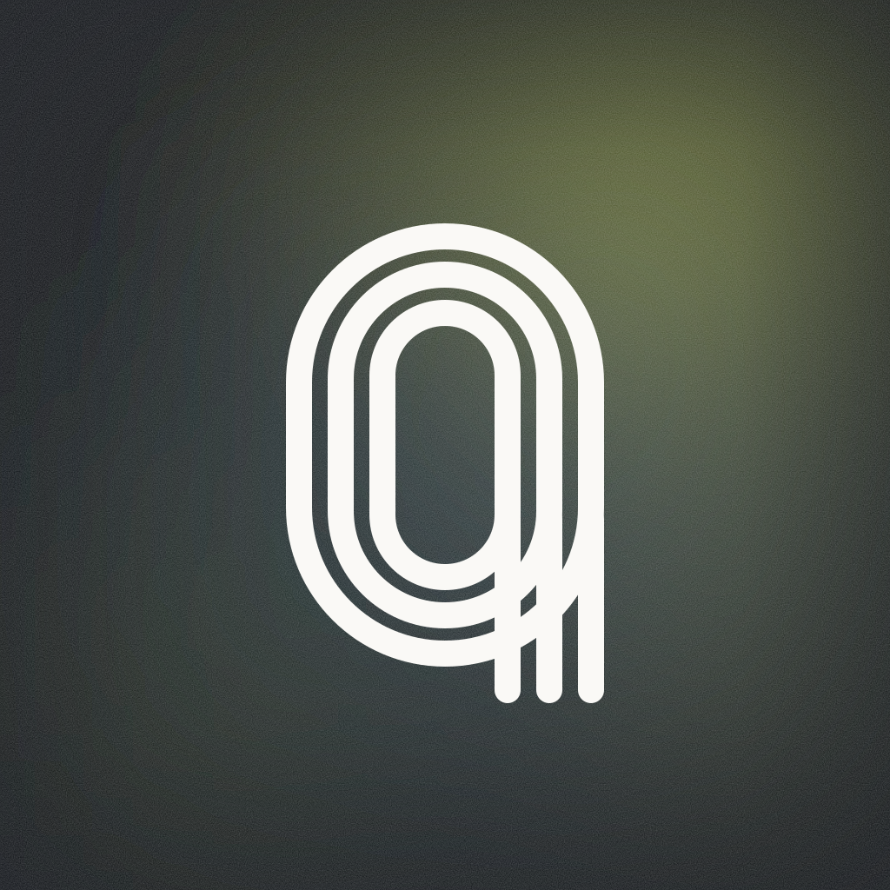

<p align="center"></p>

# athletedata MCP server

Your Garmin, Oura, WHOOP, Hevy and 35 more fitness apps, queryable from your own AI.

athletedata is a hosted MCP server for athletes. Connect your training and health apps once at athletedata.health, then ask your own AI about your data.

It reads 39 apps and computes the numbers on top: training load (CTL, ATL, TSB), HRV and resting heart rate trends, readiness, sleep trends, power and pace curves, race predictions, intensity distribution and load spikes. With your permission it can also write back: push a structured workout to your Garmin or COROS (through Intervals.icu) or Apple Watch (through the athletedata iPhone app), log food, or create a Hevy routine.

**Server:** `https://mcp.athletedata.health/mcp` (Streamable HTTP)
**Account:** [start a 7-day free trial](https://www.athletedata.health/login?ref=mcp&utm_source=github&utm_medium=mcp-directory), then find your key at [www.athletedata.health/dashboard/mcp](https://www.athletedata.health/dashboard/mcp).
**More:** [athletedata.health/mcp](https://www.athletedata.health/mcp?utm_source=github&utm_medium=mcp-directory)

## What it reads

- **Activity and power:** Garmin, Wahoo, Intervals.icu, TrainingPeaks, Polar, COROS, Suunto, Zepp, Zwift, Rouvy, MyWhoosh, Peloton, TrainerRoad, Hammerhead Karoo, Concept2
- **Sleep and recovery:** Oura, WHOOP, Ultrahuman, Garmin, Withings, Apple Health, Google Health (Fitbit, Pixel Watch), COROS, Suunto, Zepp, Eight Sleep
- **Heart:** Frontier X (ECG)
- **Strength:** Hevy, Strong, Fitbod, Technogym
- **Nutrition:** Cronometer, MyFitnessPal, Yazio, Lose It!, Lifesum, Fuelin
- **Body composition:** Renpho, Withings
- **Cycle tracking:** Clue, Flo
- **Calendar and docs:** Google Calendar, Apple Calendar, Google Sheets

Strava data is not available over MCP: Strava's API terms do not allow serving it to third-party AI tools.

## Two ways to sign in

1. **OAuth (recommended where the client supports it).** Add the bare URL
   `https://mcp.athletedata.health/mcp` and sign in with your athletedata account. The consent
   screen lists what the app asked for, and you can revoke it any time under
   Settings, Connected apps.
2. **API key.** Send `Authorization: Bearer sk_soma_...` with every request.
   The key is on [your MCP page](https://www.athletedata.health/dashboard/mcp). Treat it like a password.

## Setup by client

### Claude (claude.ai, Claude Desktop)

Settings, Connectors, **Add custom connector**, paste `https://mcp.athletedata.health/mcp`, then sign in.
Guide: [athletedata.health/mcp/setup/claude-desktop](https://www.athletedata.health/mcp/setup/claude-desktop?utm_source=claude&utm_medium=mcp-directory)
No account yet? [Start free](https://www.athletedata.health/login?ref=mcp&utm_source=claude&utm_medium=mcp-directory).

### Claude Code

```bash
claude mcp add --transport http athletedata https://mcp.athletedata.health/mcp
```

Then run `/mcp` inside Claude Code and sign in. No account yet? [Start free](https://www.athletedata.health/login?ref=mcp&utm_source=claude-code&utm_medium=mcp-directory).

### ChatGPT

Guide: [athletedata.health/mcp/setup/chatgpt](https://www.athletedata.health/mcp/setup/chatgpt?utm_source=chatgpt&utm_medium=mcp-directory)
No account yet? [Start free](https://www.athletedata.health/login?ref=mcp&utm_source=chatgpt&utm_medium=mcp-directory).

### Cursor

[](https://cursor.com/en/install-mcp?name=athletedata&config=eyJ1cmwiOiJodHRwczovL21jcC5hdGhsZXRlZGF0YS5oZWFsdGgvbWNwIn0%3D)

The button adds the server and Cursor asks you to sign in. To use a key
instead, put this in `~/.cursor/mcp.json` and set `ATHLETEDATA_API_KEY` in your environment:

```json
{
  "mcpServers": {
    "athletedata": {
      "url": "https://mcp.athletedata.health/mcp",
      "headers": { "Authorization": "Bearer ${env:ATHLETEDATA_API_KEY}" }
    }
  }
}
```

This repo is also a Cursor plugin (`.cursor-plugin/plugin.json`).
No account yet? [Start free](https://www.athletedata.health/login?ref=mcp&utm_source=cursor&utm_medium=mcp-directory).

### VS Code (GitHub Copilot)

```bash
code --add-mcp '{"name":"athletedata","type":"http","url":"https://mcp.athletedata.health/mcp"}'
```

VS Code asks you to sign in on first use. No account yet? [Start free](https://www.athletedata.health/login?ref=mcp&utm_source=vscode&utm_medium=mcp-directory).

### Gemini CLI

```bash
gemini extensions install https://github.com/athletedata-health/mcp
```

The installer asks for your API key and keeps it in your system keychain.
No account yet? [Start free](https://www.athletedata.health/login?ref=mcp&utm_source=gemini-cli&utm_medium=mcp-directory).

### OpenClaw

Sign in with OAuth:

```bash
openclaw mcp add athletedata --url https://mcp.athletedata.health/mcp --transport streamable-http --auth oauth
openclaw mcp login athletedata
```

Or with a key (set `ATHLETEDATA_API_KEY` in your environment; single quotes keep the
placeholder in config, and `--no-probe` is needed because the add-time probe
does not expand it):

```bash
openclaw mcp add athletedata --url https://mcp.athletedata.health/mcp --transport streamable-http --header 'Authorization=Bearer ${ATHLETEDATA_API_KEY}' --no-probe
openclaw mcp probe athletedata
```

The matching skill tells your agent when to reach for it: `clawhub install athletedata`.
No account yet? [Start free](https://www.athletedata.health/login?ref=mcp&utm_source=openclaw&utm_medium=mcp-directory).

### Hermes Agent

```bash
echo 'ATHLETEDATA_API_KEY=sk_soma_...' >> ~/.hermes/.env
hermes plugins install athletedata-health/mcp
hermes plugins enable athletedata
```

No account yet? [Start free](https://www.athletedata.health/login?ref=mcp&utm_source=hermes&utm_medium=mcp-directory).

### Mistral Le Chat

Connectors, **Add connector**, Custom MCP connector, paste `https://mcp.athletedata.health/mcp`, then sign in.
No account yet? [Start free](https://www.athletedata.health/login?ref=mcp&utm_source=mistral&utm_medium=mcp-directory).

### Any other MCP client

URL `https://mcp.athletedata.health/mcp`, transport Streamable HTTP, header `Authorization: Bearer sk_soma_...`.
Clients that only speak stdio can bridge with `npx mcp-remote https://mcp.athletedata.health/mcp --header "Authorization:Bearer ${ATHLETEDATA_API_KEY}"`.

## What is in this repo

Manifests only. The server itself is hosted by athletedata; nothing here runs on your machine.

| File | For |
|---|---|
| `server.json` | [Official MCP Registry](https://registry.modelcontextprotocol.io) |
| `gemini-extension.json`, `GEMINI.md` | Gemini CLI extension |
| `plugin.json`, `mcp.json`, `skills/` | Agent Plugins package (Hermes Agent, Cursor) |
| `.cursor-plugin/plugin.json` | Cursor plugin |
| `clawhub/athletedata/SKILL.md` | ClawHub skill for OpenClaw |
| `glama.json` | Glama listing ownership |
| `build/build.mjs` | Renders all of the above from one source |

## Privacy

Your data stays yours: we do not sell it and do not train models on it, and you can delete everything from the dashboard. Details: [athletedata.health/trust](https://www.athletedata.health/trust).
Questions: team@athletedata.health

Made by HealthspanOS AG, Zurich.
